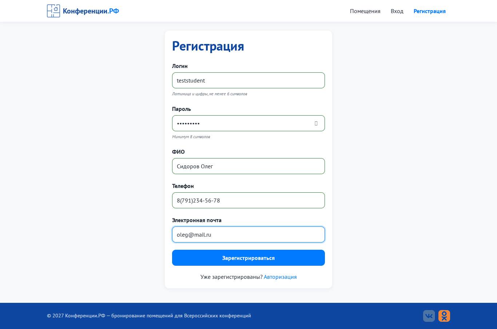

# Задание № 1. Чек-лист, 5 тест-кейсов и баг-репорт

Чек-лист из 26 проверок, 5 тест-кейсов (TC-01…TC-05) и тест-сьют для веб-сервиса «Конференции.РФ». Найдены и оформлены **2 реальных дефекта**: BUG-01 (маска телефона искажает номер, введённый с +7) и BUG-02 (логины, отличающиеся только регистром).

| Файл | Что это |
|---|---|
| [`Тестовая_документация.docx`](Тестовая_документация.docx) | отчёт в Word |
| [`Тестовая_документация.md`](Тестовая_документация.md) | тот же отчёт в Markdown |
| `img/bug_01_phone.png` | принтскрин BUG-01 |
| `img/bug_02_login_case.png` | принтскрин BUG-02 |

