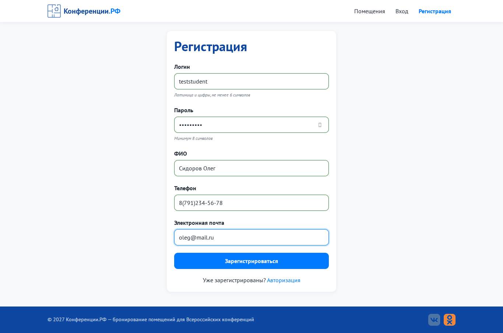
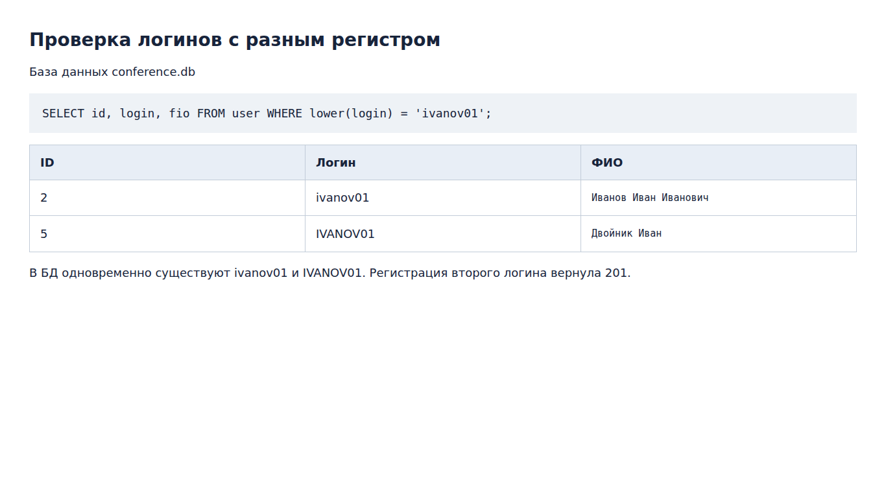

# Задание № 1. Чек-лист, тест-кейсы и баг-репорт для веб-сервиса

**Объект тестирования:** веб-сервис «Конференции.РФ» - бронирование помещений для конференций (собственное учебное приложение по МДК.09.01, репозиторий `IG_MDK09.01`, папка `ПР11_Веб-приложение_по_ТЗ/code`)
**Окружение исходных проверок:** Linux, Chromium 153, разрешение 1366×768, сервер `http://127.0.0.1:5000`
**Тестовые данные:** администратор `Conf2027 / Demo77`, участник `ivanov01 / Password1` (`python seed_demo.py`)
**Дата:** 22.10.2026 · **Тестировщик:** Сунатуллин Р. Р.

---

## 1. Чек-лист

| № | Проверка | Результат |
|---|---|:-:|
| **Главная (гость)** | | |
| 1 | Главная открывается, видны 3 помещения: название, вместимость, фото | ✅ Passed |
| 2 | Кнопки «Зарегистрироваться» и «Войти» ведут на нужные страницы | ✅ Passed |
| 3 | Гость, открывший `/dashboard` или `/admin`, перенаправляется на вход | ✅ Passed |
| **Регистрация** | | |
| 4 | Все 5 полей обязательны, при пустой отправке ошибка у каждого поля | ✅ Passed |
| 5 | Логин: латиница и цифры, ≥ 6 символов | ✅ Passed |
| 6 | Логин уникален | ⚠️ Failed - см. BUG-02 (регистр букв) |
| 7 | Пароль ≥ 8 символов | ✅ Passed |
| 8 | ФИО: только кириллица и пробелы | ✅ Passed |
| 9 | Телефон в формате `8(XXX)XXX-XX-XX`, работает маска | ⚠️ Failed - см. BUG-01 (ввод с +7) |
| 10 | E-mail в формате почты | ✅ Passed |
| 11 | Ссылка «Уже зарегистрированы? Авторизация» | ✅ Passed |
| **Авторизация** | | |
| 12 | Вход участника открывает «Мои заявки» | ✅ Passed |
| 13 | Вход `Conf2027 / Demo77` открывает «Панель администратора» | ✅ Passed |
| 14 | Неверный пароль даёт сообщение «Неверный логин или пароль» | ✅ Passed |
| 15 | Ссылка «Еще не зарегистрированы? Регистрация» | ✅ Passed |
| 16 | После 5 неверных попыток вход временно блокируется | ✅ Passed |
| **Заявка** | | |
| 17 | Помещение и способ оплаты выбираются из выпадающих списков | ✅ Passed |
| 18 | Нельзя указать прошедшую дату | ✅ Passed |
| 19 | После «Отправить» заявка появляется в кабинете со статусом «Новая» | ✅ Passed |
| **Администратор** | | |
| 20 | Видны все заявки всех пользователей | ✅ Passed |
| 21 | Статус меняется: Новая → Мероприятие назначено → Завершено | ✅ Passed |
| 22 | Фильтры по статусу и помещению, поиск по логину и ФИО работают | ✅ Passed |
| **Отзывы** | | |
| 23 | Форма отзыва есть только у заявок со статусом «Завершено» | ✅ Passed |
| 24 | Повторный отзыв на ту же заявку невозможен | ✅ Passed |
| **Общее** | | |
| 25 | Вёрстка не ломается на 390×844 | ✅ Passed |
| 26 | Орфография в интерфейсе без ошибок | ✅ Passed |

**Итог:** 26 проверок, 24 пройдено, 2 не пройдено (заведены баг-репорты).

---

## 2. Тест-кейсы

### TC-01. Успешная регистрация участника
| Поле | Значение |
|---|---|
| **Приоритет** | High |
| **Предусловия** | Открыта страница `/register`, логина `student01` нет в системе |
| **Шаги** | 1. Ввести логин `student01` 2. Пароль `Password1` 3. ФИО `Сидоров Олег Петрович` 4. Телефон `89161234567` 5. E-mail `oleg@mail.ru` 6. Нажать «Зарегистрироваться» |
| **Ожидаемый результат** | Телефон отображается как `8(916)123-45-67`; появляется уведомление «Пользователь создан. Теперь войдите в систему.»; открывается страница `/login` |
| **Фактический результат** | Совпадает с ожидаемым |
| **Статус** | ✅ Passed |

### TC-02. Регистрация с занятым логином
| Поле | Значение |
|---|---|
| **Приоритет** | High |
| **Предусловия** | В системе есть пользователь `ivanov01` |
| **Шаги** | 1. Открыть `/register` 2. Заполнить все поля корректно, логин `ivanov01` 3. Нажать «Зарегистрироваться» |
| **Ожидаемый результат** | Под полем «Логин» ошибка «Такой логин уже занят», пользователь не создан |
| **Фактический результат** | Совпадает с ожидаемым |
| **Статус** | ✅ Passed |

### TC-03. Вход с неверным паролем
| Поле | Значение |
|---|---|
| **Приоритет** | High |
| **Предусловия** | Пользователь `ivanov01` зарегистрирован |
| **Шаги** | 1. Открыть `/login` 2. Логин `ivanov01`, пароль `wrongpass` 3. Нажать «Войти» |
| **Ожидаемый результат** | Над формой сообщение «Неверный логин или пароль», поле пароля очищено, остаёмся на `/login` |
| **Фактический результат** | Совпадает с ожидаемым |
| **Статус** | ✅ Passed |

### TC-04. Создание заявки участником
| Поле | Значение |
|---|---|
| **Приоритет** | High |
| **Предусловия** | Участник авторизован |
| **Шаги** | 1. Нажать «+ Новая заявка» 2. Выбрать помещение «Кинозал» 3. Указать дату и время через неделю, 10:00 4. Выбрать оплату «Перевод по СБП» 5. Нажать «Отправить» |
| **Ожидаемый результат** | Уведомление «Заявка отправлена администратору»; в «Мои заявки» появилась карточка «Кинозал» со статусом «Новая» |
| **Фактический результат** | Совпадает с ожидаемым |
| **Статус** | ✅ Passed |

### TC-05. Отзыв доступен только после завершения мероприятия
| Поле | Значение |
|---|---|
| **Приоритет** | Medium |
| **Предусловия** | У участника есть заявка со статусом «Новая» |
| **Шаги** | 1. Открыть «Мои заявки» и убедиться, что формы отзыва нет 2. Войти администратором и перевести заявку в «Завершено» 3. Снова войти участником 4. Поставить 4 звезды, ввести «Всё прошло отлично, спасибо!» и отправить |
| **Ожидаемый результат** | Шаг 1: вместо формы подсказка «Отзыв можно будет оставить после завершения мероприятия». Шаг 4: отзыв со звёздами отображается в карточке, форма исчезла |
| **Фактический результат** | Совпадает с ожидаемым |
| **Статус** | ✅ Passed |

---

## 3. Баг-репорты

### BUG-01. Телефон, введённый с «+7», сохраняется с искажённым номером
| Поле | Значение |
|---|---|
| **Серьёзность (Severity)** | Major |
| **Приоритет** | High |
| **Статус** | Открыт |
| **Окружение** | Chromium 153, Linux, `http://127.0.0.1:5000/register` |
| **Шаги воспроизведения** | 1. Открыть `/register` 2. В поле «Телефон» ввести `+79123456789` (как номер обычно записан в контактах) 3. Убрать фокус с поля |
| **Ожидаемый результат** | `8(912)345-67-89`: код страны +7 заменяется на 8 |
| **Фактический результат** | `8(791)234-56-78`: маска дописывает 8 перед 7, номер сдвигается, последняя цифра теряется. Поле подсвечено **зелёным** как корректное, поэтому неверный номер сохраняется в БД |
| **Причина (для разработчика)** | `register.js`: если первая цифра не `8`, к строке добавляется `8`, а ведущая `7` не заменяется |
| **Вложения** | `img/bug_01_phone.png` |

### BUG-02. Можно зарегистрировать логин, отличающийся только регистром букв
| Поле | Значение |
|---|---|
| **Серьёзность (Severity)** | Minor |
| **Приоритет** | Medium |
| **Статус** | Открыт |
| **Окружение** | Chromium 153, API `POST /api/register` |
| **Шаги воспроизведения** | 1. Убедиться, что существует пользователь `ivanov01` 2. Зарегистрировать нового пользователя с логином `IVANOV01` |
| **Ожидаемый результат** | Ошибка «Такой логин уже занят»: логины, отличающиеся регистром, путают пользователей и администратора |
| **Фактический результат** | Ответ `201 Created`, в таблице `user` две записи: `ivanov01` (Иванов Иван Иванович) и `IVANOV01` (Двойник Иван) |
| **Вложения** | `img/bug_02_login_case.png` (выборка из БД) |

---

## 4. Тест-сьют

| Тест-сьют | Тест-кейсы | Назначение |
|---|---|---|
| **TS-01 «Регистрация и авторизация»** | TC-01, TC-02, TC-03 | проверка входа в систему, перед каждым релизом |
| **TS-02 «Заявки и отзывы»** | TC-04, TC-05 | основной бизнес-процесс |
| **TS-Smoke** | TC-01, TC-03, TC-04 | быстрая проверка после любой сборки |

## 5. Иллюстрации дефектов

| BUG-01. Маска телефона | BUG-02. Логины, отличающиеся регистром |
|---|---|
|  |  |
