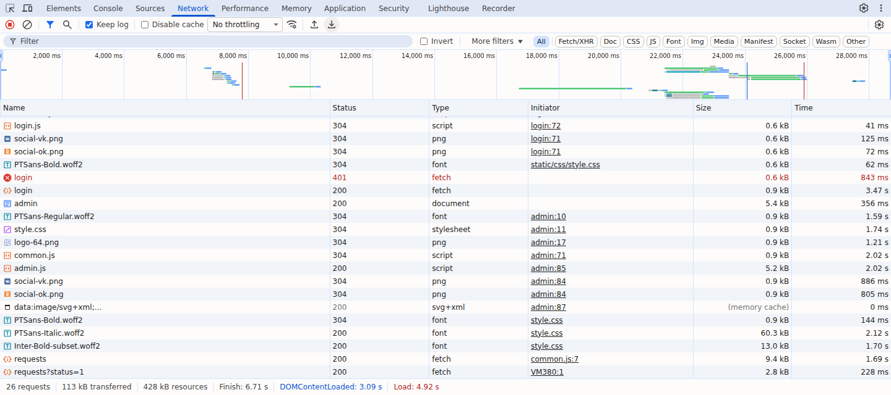
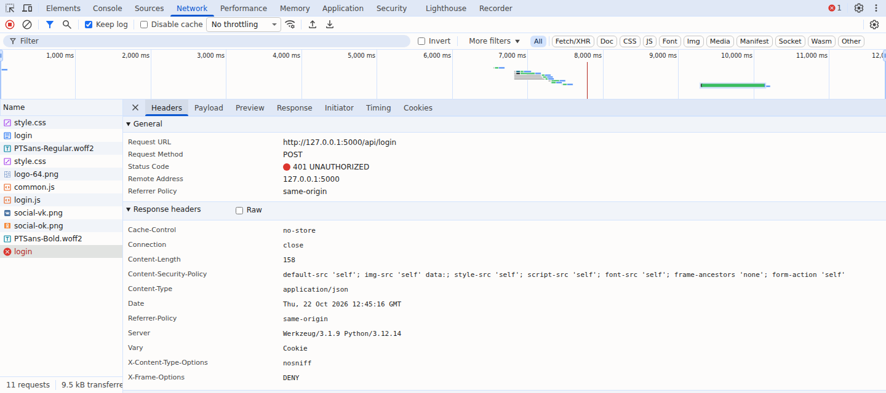
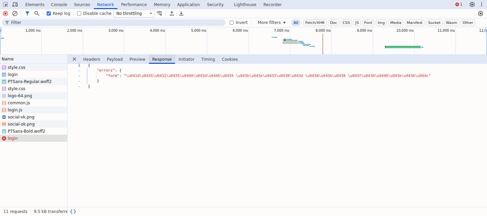
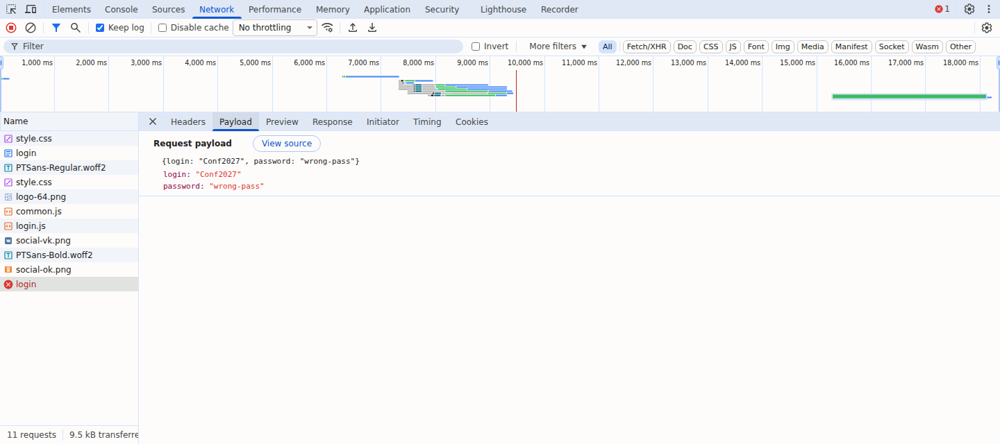
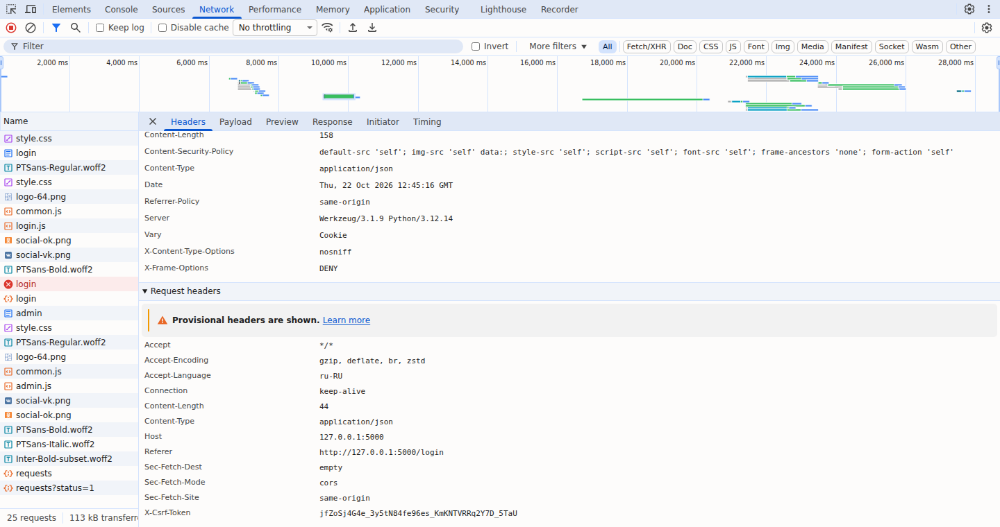

# Задание № 2. Анализ HTTP-запроса и ответа через DevTools

В отчёте разобраны четыре запроса: загрузка страницы входа, вход с неверным паролем (401), успешный вход (200) и получение заявок с фильтром.

| Файл | Содержание |
|---|---|
| [`Анализ_HTTP.docx`](Анализ_HTTP.docx) | отчёт в Word |
| [`Анализ_HTTP.md`](Анализ_HTTP.md) | тот же отчёт в Markdown |
| `img/01_login_401_headers.png` | запрос login: метод POST, статус 401 и заголовки |
| `img/02_login_401_response.png` | тело ответа того же запроса |
| `img/03_login_401_payload.png` | тело запроса login: логин и пароль |
| `img/04_login_request_headers.png` | заголовки запроса: Content-Type и X-CSRF-Token |
| `img/05_network_requests_list.png` | общий список запросов |
| `data/conference_login.har` | запись запросов, открывается через Import HAR |
| `data/captured_requests.json` | данные запросов и ответов |

Из копий HAR и JSON удалены заголовки User-Agent и Sec-CH-UA. Содержимое запросов и ответов не подменялось.

## Общий список запросов

## Headers

## Response

## Payload

## Request Headers
Снимок получен при просмотре той же HAR-записи, в копии которой удалены идентифицирующие заголовки браузера.

