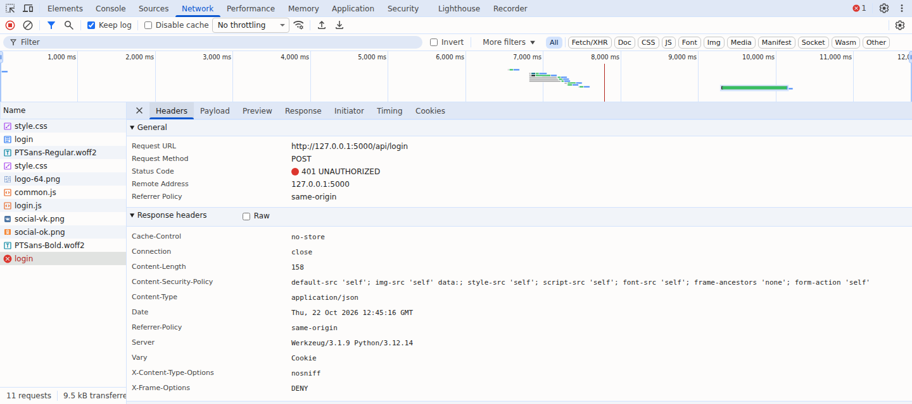
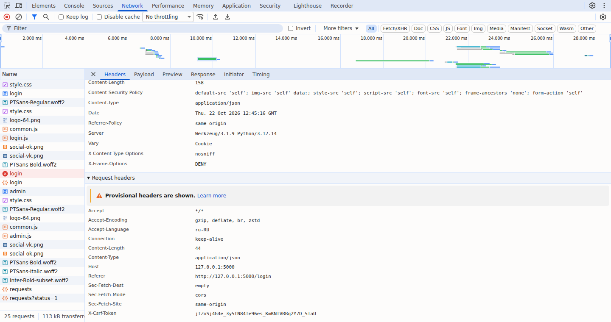
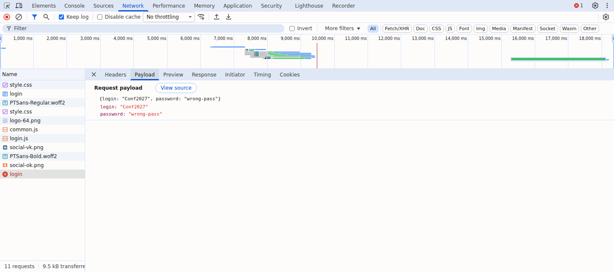
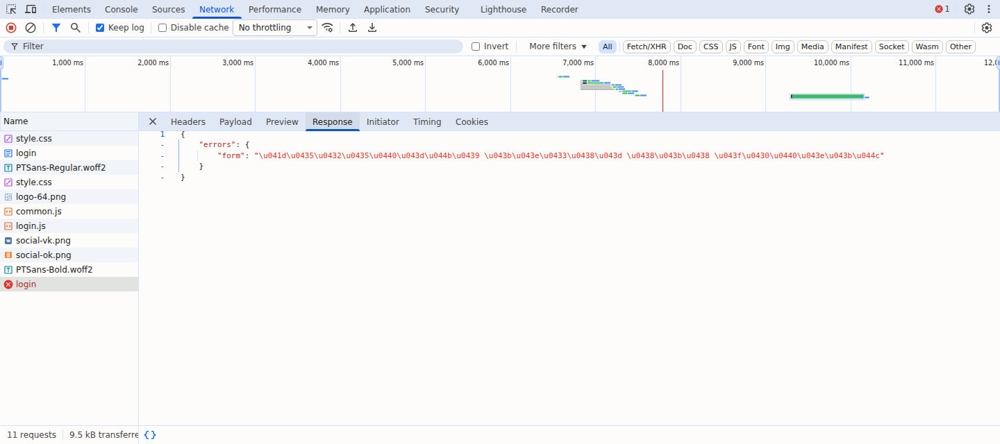

# Задание № 2. Анализ HTTP-запроса и ответа через DevTools

**Сайт:** «Конференции.РФ» (`http://127.0.0.1:5000`)
**Инструмент:** Chrome DevTools → вкладка **Network** (F12 → Network → флажок *Keep log*)
**Действие:** вход на странице `/login`: сначала с неверным паролем, затем с верным

Запросы и ответы сохранены в файлах `data/conference_login.har` (в DevTools: Network → *Import HAR*, иконка ⬆) и `data/captured_requests.json`.

Из копий HAR и JSON удалены идентифицирующие заголовки браузера (`User-Agent`, `Sec-CH-UA`). Методы, адреса, статусы и тела запросов и ответов сохранены без подмены.

---

## Запрос 1. Загрузка страницы авторизации

| Параметр | Значение |
|---|---|
| **URL** | `http://127.0.0.1:5000/login` |
| **Метод** | `GET` (получить страницу, тела запроса нет) |
| **Статус-код** | `200 OK` |
| **Content-Type ответа** | `text/html; charset=utf-8` |
| **Размер ответа** | `Content-Length: 3455` байт |
| **Тело ответа** | HTML-страница; в `<meta name="csrf-token">` лежит токен для следующих запросов |

Важные заголовки ответа:
| Заголовок | Значение | Зачем |
|---|---|---|
| `Set-Cookie` | `conf_session=...; HttpOnly; Path=/; SameSite=Lax` | сервер выдаёт cookie сессии. `HttpOnly` закрывает её от JavaScript, `SameSite=Lax` не отправляет её с чужих сайтов |
| `Content-Security-Policy` | `default-src 'self'; script-src 'self'; ...` | браузеру разрешены только скрипты, стили и шрифты с этого же сайта |
| `X-Frame-Options` | `DENY` | страницу нельзя встроить в чужой `<iframe>` (защита от кликджекинга) |
| `X-Content-Type-Options` | `nosniff` | браузер не «угадывает» тип файла |
| `Server` | `Werkzeug/3.1.9 Python/3.12.14` | версия сервера (в продакшене её лучше скрывать) |

## Запрос 2. Вход с неверным паролем

| Параметр | Значение |
|---|---|
| **URL** | `http://127.0.0.1:5000/api/login` |
| **Метод** | `POST` (отправка данных на сервер) |
| **Статус-код** | **`401 UNAUTHORIZED`**: пользователь не прошёл аутентификацию |

**Заголовки запроса:**
| Заголовок | Значение | Зачем |
|---|---|---|
| `Content-Type` | `application/json` | тело запроса - JSON |
| `X-CSRF-Token` | `<токен из meta csrf-token>` | токен из `<meta>`, без него сервер вернёт 400 (защита от CSRF) |
| `Cookie` | `conf_session=<cookie сессии>` | браузер сам отправляет cookie сессии |
| `Accept` | `*/*` | клиент примет ответ любого типа |

**Тело запроса (Payload):**
```json
{"login": "Conf2027", "password": "wrong-pass"}
```
**Заголовки ответа:** `Content-Type: application/json`, `Cache-Control: no-store` (ответ API не кэшируется), `Content-Length: 158`.

**Тело ответа (Response):**
```json
{"errors": {"form": "Неверный логин или пароль"}}
```
> В «сыром» виде на вкладке *Response* кириллица представлена escape-последовательностями вида `\u041d\u0435\u0432...`: Flask по умолчанию экранирует не-ASCII символы в JSON. Вкладка *Preview* показывает нормальный текст. На работу это не влияет, но для удобства отладки можно выключить экранирование (`app.json.ensure_ascii = False`).

## Запрос 3. Вход с верным паролем

| Параметр | Значение |
|---|---|
| **URL** | `http://127.0.0.1:5000/api/login` |
| **Метод** | `POST` |
| **Статус-код** | **`200 OK`** |
| **Тело запроса** | `{"login": "Conf2027", "password": "Demo77"}` |
| **Тело ответа** | `{"message": "Вход выполнен", "redirect": "/admin"}` |
| **Set-Cookie** | новая сессия после успешного входа (`session.clear()` в `auth_routes.py`) |

После входа сервер выдаёт **новую** сессию (защита от фиксации сессии) со сроком жизни 2 часа (`Expires`). По полю `redirect` JavaScript переходит на `/admin`.

## Запрос 4. Загрузка заявок с фильтром

| Параметр | Значение |
|---|---|
| **URL** | `http://127.0.0.1:5000/api/admin/requests?status=1` |
| **Метод** | `GET`, параметр фильтра передан в строке запроса (`?status=1` - «Новая») |
| **Статус-код** | `200 OK` |
| **Тело запроса** | нет (у GET тела нет) |
| **Тело ответа** | JSON: `{"requests": [{"id": 4, "login": "petrova22", "fio": "Петрова Анна Сергеевна", "room": "Коворкинг", "status": "Новая", ...}], "stats": {"1": 3, "2": 6, "3": 3}}`, 2002 байта |

---

## Выводы
1. Сайт использует методы **GET** (получение страниц и данных) и **POST** (отправка формы входа). Смена статуса в админке использует **PATCH**.
2. Коды ответа соответствуют ситуации: `200` при успехе, `401` при неверном пароле. В других сценариях встречаются `201` (создан), `400` (без CSRF), `403` (нет прав), `422` (ошибки валидации), `429` (слишком много попыток).
3. Обмен с API идёт в формате JSON, заголовки безопасности (`CSP`, `X-Frame-Options`, `HttpOnly`, `SameSite`) на месте.
4. Пароль передаётся открытым текстом, потому что локальный стенд работает по HTTP. На боевом сервере нужен **HTTPS** (тогда включается и флаг cookie `Secure`).

## Как повторить самому
1. Запустить приложение (`cd ПР11_Веб-приложение_по_ТЗ/code && python run.py`) и открыть `http://127.0.0.1:5000/login`.
2. Нажать **F12**, открыть вкладку **Network**, включить *Keep log*.
3. Ввести `Conf2027` и неверный пароль, нажать «Войти».
4. Кликнуть строку `login` в списке и посмотреть вкладки **Headers** (метод, статус, заголовки), **Payload** (тело запроса), **Response** / **Preview** (тело ответа).
5. Сделать принтскрин вкладок Headers и Response.

## Принтскрины

### Запрос login с ответом 401 - Headers


### Заголовки запроса - Request Headers
Сохранённые Content-Type и X-CSRF-Token при просмотре той же HAR-записи. Идентифицирующие заголовки браузера удалены из копии HAR, остальные значения не заменялись.



### Тело запроса - Payload


### Тело ответа 401 - Response

