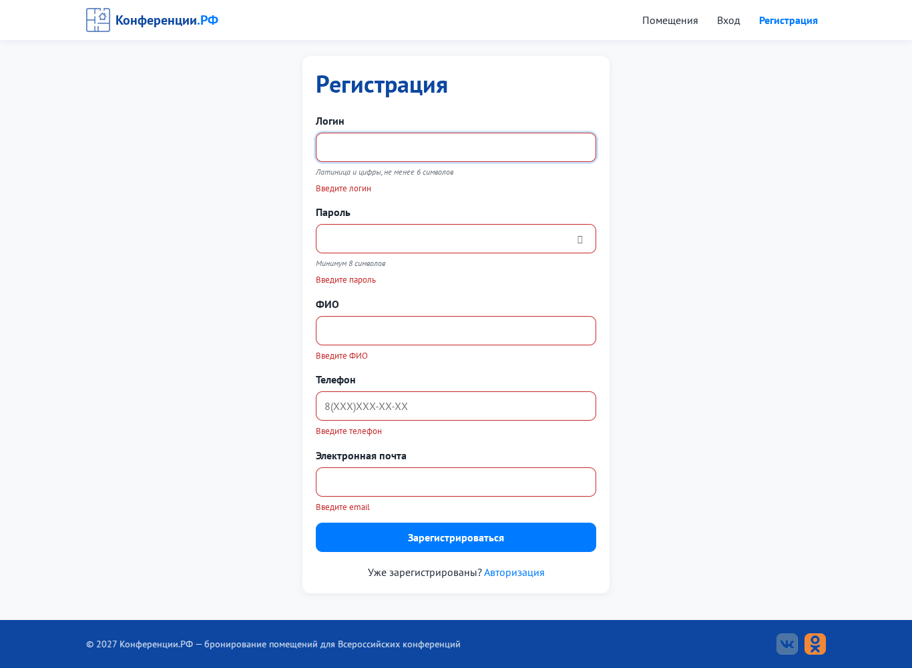
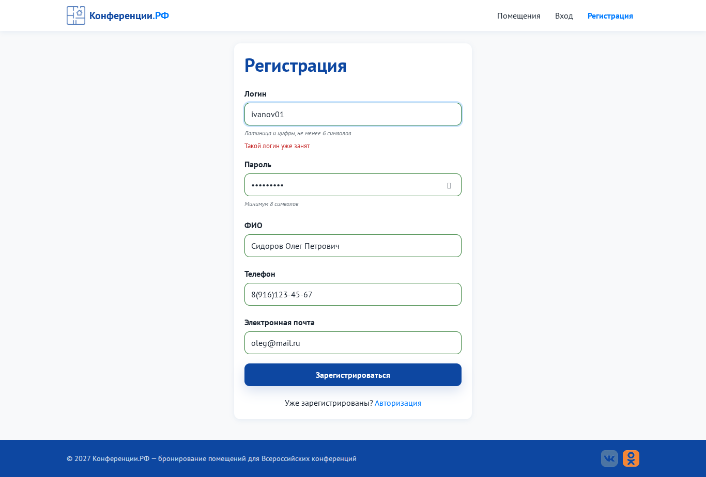
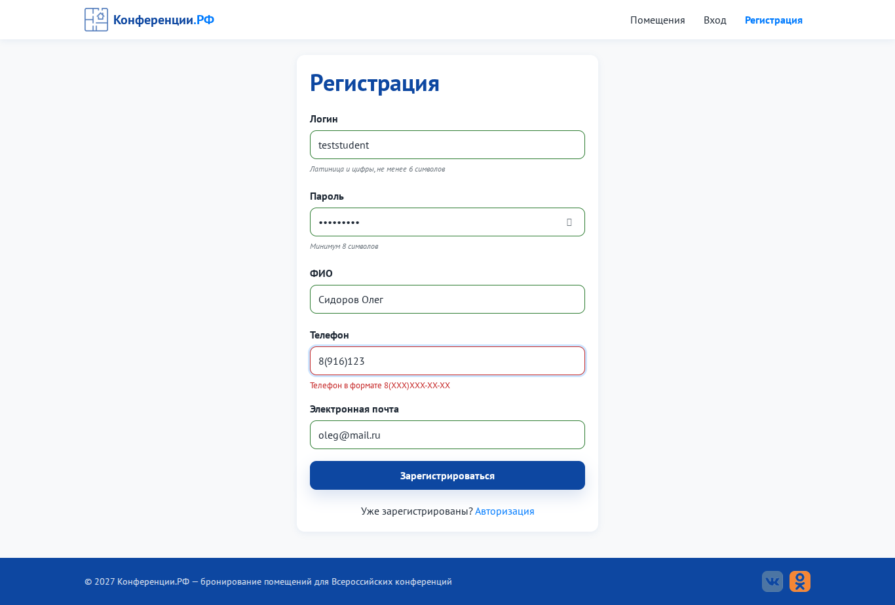
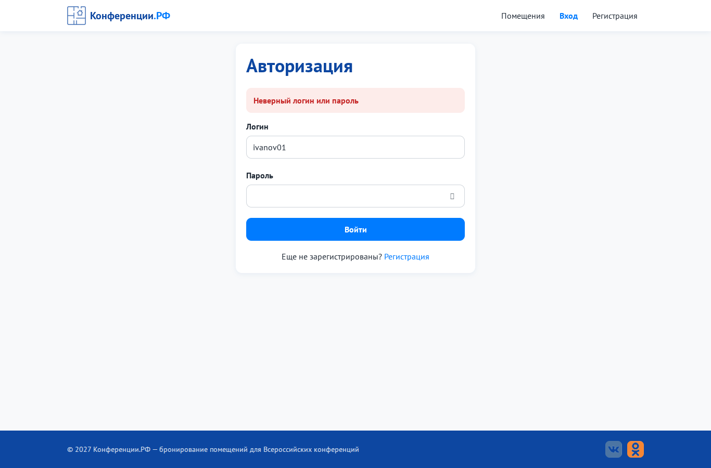

# Задание № 3. Тестирование формы регистрации и авторизации

Проверена валидация всех полей, выполнено 19 позитивных и негативных сценариев (12 - регистрация, 7 - авторизация): 17 Pass, 2 Fail (дефекты BUG-01, BUG-02 из задания 1). Проверены тексты на ошибки.

| Файл | Что это |
|---|---|
| [`Тестирование_форм.docx`](Тестирование_форм.docx) | отчёт в Word |
| [`Тестирование_форм.md`](Тестирование_форм.md) | тот же отчёт в Markdown |
| `img/R-02_empty_form.png` | R-02: пустая форма регистрации |
| `img/R-05_login_taken.png` | R-05: занятый логин |
| `img/R-08_bad_phone.png` | R-08: неполный телефон |
| `img/L-02_wrong_password.png` | L-02: неверный пароль при входе |

| R-02 - пустая форма | R-05 - занятый логин |
|---|---|
|  |  |

| R-08 - неверный телефон | L-02 - неверный пароль |
|---|---|
|  |  |
