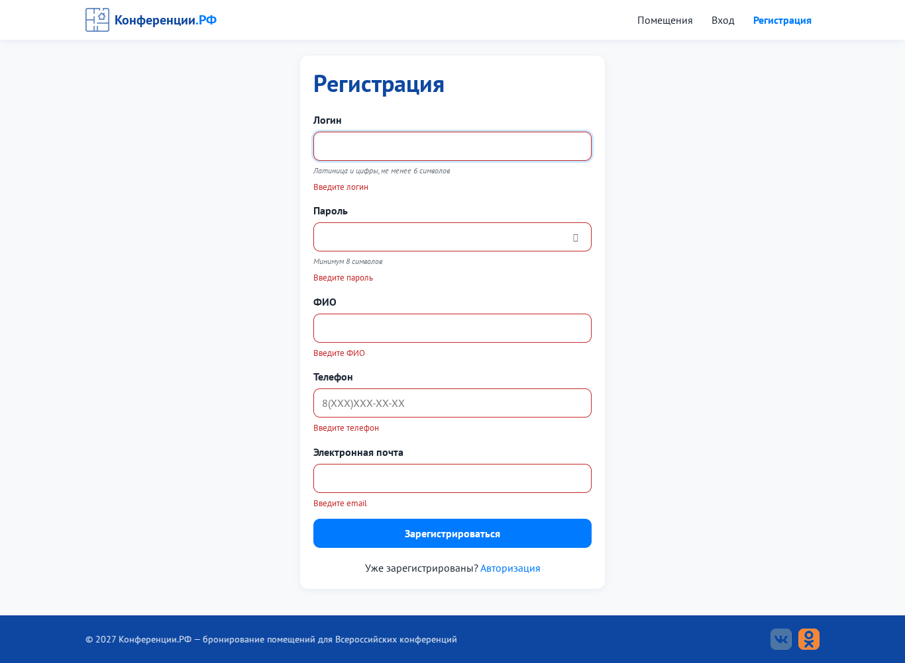
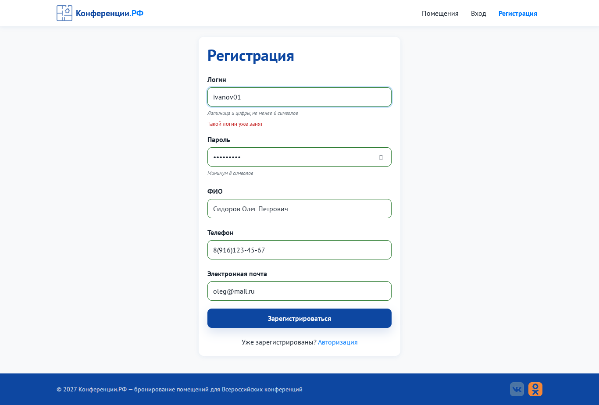
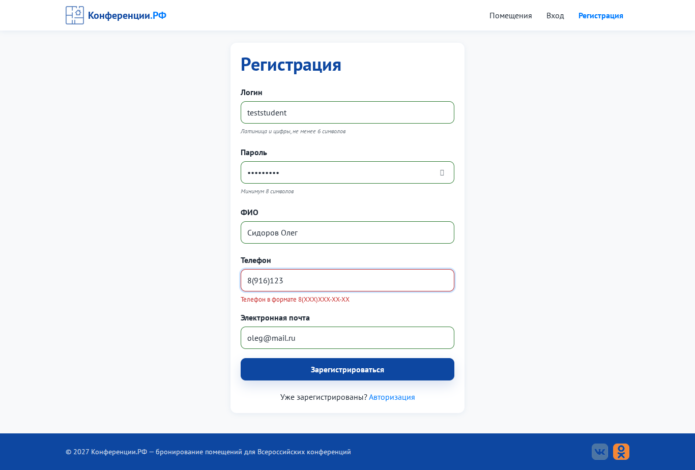
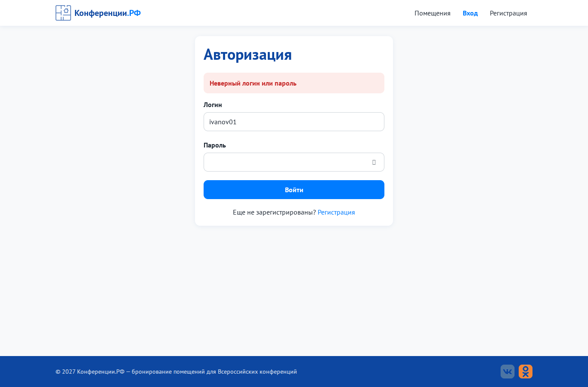

# Задание № 3. Тестирование формы регистрации и авторизации

**Объект:** формы `/register` и `/login` портала «Конференции.РФ»
**Требования к полям (из ТЗ):** логин - латиница и цифры, ≥ 6 символов, уникальный; пароль ≥ 8 символов; ФИО - кириллица и пробелы; телефон `8(XXX)XXX-XX-XX`; e-mail в формате почты; все поля обязательны.
**Способ выполнения:** проверка форм в браузере и запросов к API. Для повторения приведены входные данные и ожидаемые сообщения.

## 1. Валидация полей формы регистрации

| Поле | Проверка | Как реагирует форма |
|---|---|---|
| все | пустое значение | ошибка «Введите …» под полем, рамка красная, поле «встряхивается» |
| все | уход с поля (blur) | ошибка показывается сразу, без отправки формы |
| все | исправление поля | ошибка пропадает во время ввода, рамка становится зелёной |
| все | обход проверки в браузере (запрос напрямую к API) | сервер повторяет те же проверки и возвращает `422` с ошибками → валидация продублирована на сервере |

## 2. Сценарии регистрации

Если не указано иначе, остальные поля корректны: пароль `Password1`, ФИО `Сидоров Олег`, телефон `89161234567`, e-mail `o@mail.ru`.

| ID | Тип | Входные данные | Ожидаемый результат | Фактический результат | Статус |
|---|---|---|---|---|---|
| R-01 | позитивный | `student01` / `Password1` / `Сидоров Олег Петрович` / `89161234567` / `oleg@mail.ru` | уведомление «Пользователь создан», переход на `/login` | «Пользователь создан. Теперь войдите в систему.», URL `/login` | ✅ Pass |
| R-02 | негативный | все поля пустые | ошибки у всех 5 полей | 5 ошибок: login, password, fio, phone, email | ✅ Pass |
| R-03 | негативный | логин `abc12` (5 символов) | «Логин: только латиница и цифры, не менее 6 символов» | то же | ✅ Pass |
| R-04 | негативный | логин `логин123` (кириллица) | «Логин: только латиница и цифры, не менее 6 символов» | то же | ✅ Pass |
| R-05 | негативный | логин `ivanov01` (уже занят) | «Такой логин уже занят» | то же | ✅ Pass |
| R-06 | негативный | пароль `1234567` (7 символов) | «Пароль должен быть не короче 8 символов» | то же | ✅ Pass |
| R-07 | негативный | ФИО `Sidorov Oleg` (латиница) | «ФИО: только кириллица и пробелы» | то же | ✅ Pass |
| R-08 | негативный | телефон `8916123` (неполный) | «Телефон в формате 8(XXX)XXX-XX-XX» | то же | ✅ Pass |
| R-09 | негативный | e-mail `oleg@mail` (без домена) | «Некорректный адрес электронной почты» | то же | ✅ Pass |
| R-10 | позитивный | ввод телефона `89161234567` | маска: `8(916)123-45-67` | `8(916)123-45-67` | ✅ Pass |
| R-11 | негативный | телефон `+79123456789` | `8(912)345-67-89` или ошибка | `8(791)234-56-78`, принят как корректный | ❌ **Fail → BUG-01** (задание 1) |
| R-12 | негативный | логин `IVANOV01` при существующем `ivanov01` | «Такой логин уже занят» | пользователь создан (201) | ❌ **Fail → BUG-02** (задание 1) |

## 3. Сценарии авторизации

| ID | Тип | Логин / пароль | Ожидаемый результат | Фактический результат | Статус |
|---|---|---|---|---|---|
| L-01 | позитивный | `ivanov01` / `Password1` | открыт «Мои заявки» | «Мои заявки» (`/dashboard`) | ✅ Pass |
| L-02 | негативный | `ivanov01` / `wrongpass` | «Неверный логин или пароль» | то же | ✅ Pass |
| L-03 | негативный | `nouser99` / `Password1` | «Неверный логин или пароль» (не раскрывает, существует ли логин) | то же | ✅ Pass |
| L-04 | негативный | пусто / пусто | «Введите логин» / «Введите пароль» | то же | ✅ Pass |
| L-05 | негативный (безопасность) | `' OR '1'='1` / `' OR '1'='1` | вход не выполнен (нет SQL-инъекции) | «Неверный логин или пароль» | ✅ Pass |
| L-06 | позитивный | `Conf2027` / `Demo77` | открыта «Панель администратора» | «Панель администратора» (`/admin`) | ✅ Pass |
| L-07 | негативный (безопасность) | 5 раз неверный пароль, затем верный | вход временно заблокирован | «Слишком много попыток. Повторите через N с.» (код 429) | ✅ Pass |

## 4. Проверка текстов на ошибки
Тексты форм, подсказок и сообщений проверены на орфографию и пунктуацию. Ошибок нет. Ссылка на регистрацию дословно совпадает с ТЗ: «Еще не зарегистрированы? Регистрация».

## 5. Итог
| Всего | Pass | Fail |
|:-:|:-:|:-:|
| 19 | 17 | 2 |

Найдены 2 дефекта (BUG-01 - маска телефона, BUG-02 - регистр логина). Баг-репорты оформлены в задании 1.

## Принтскрины
| R-02 - пустая форма | R-05 - занятый логин | R-08 - неверный телефон | L-02 - неверный пароль |
|---|---|---|---|
|  |  |  |  |
