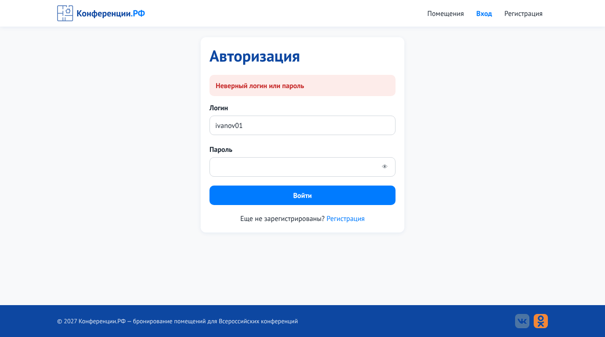
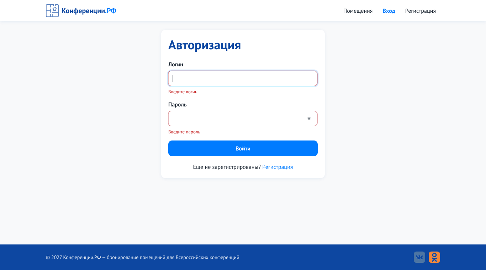
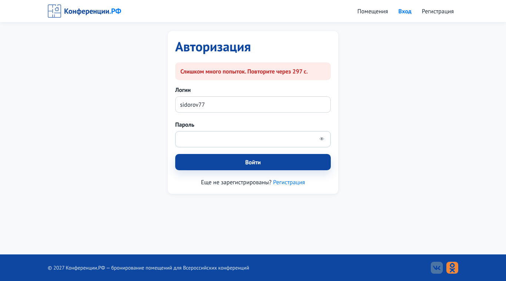
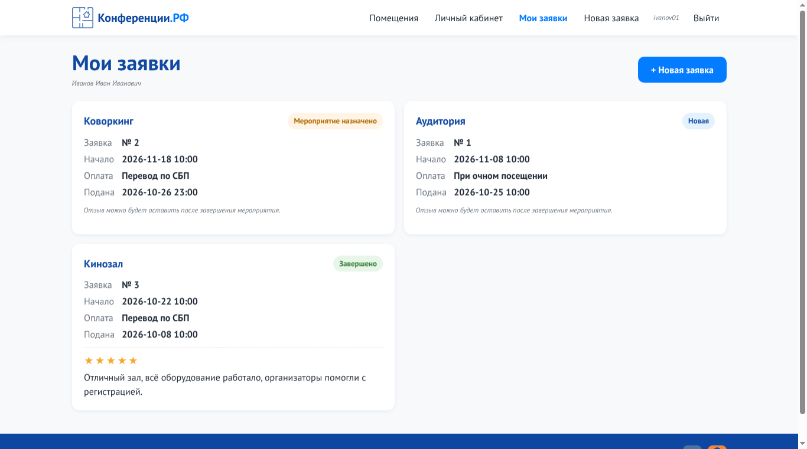
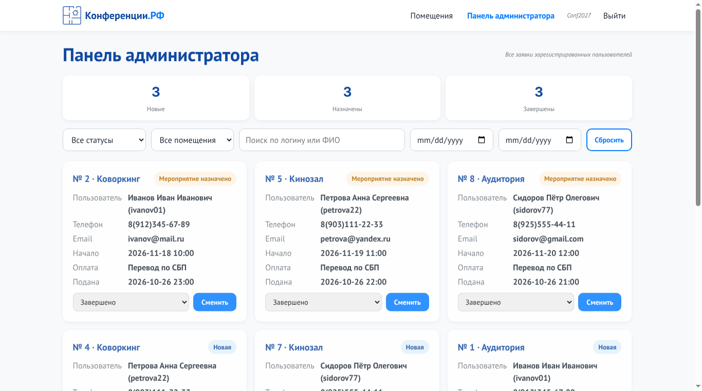

# Задание № 4. Автотест формы авторизации на Selenium

**Студент:** Сунатуллин Раиль Ринатович, группа 4ИСП9-45

**Цель:** написать автоматический тест формы авторизации с явными ожиданиями и шаблоном Page Object Model.

**Объект тестирования:** форма входа `/login` портала «Конференции.РФ».

## 1. Инструменты
| Что | Версия |
|---|---|
| Язык | Python 3 |
| Автоматизация браузера | Selenium WebDriver 4 |
| Запуск тестов и отчёт | pytest, pytest-html |
| Браузер | Chrome (в проверке: Chromium 141, headless) |
| Объект тестирования | портал «Конференции.РФ» (Flask), репозиторий `IG_MDK09.01`, папка `ПР11_Веб-приложение_по_ТЗ/code` |

## 2. Структура проекта
```
code/
├── conftest.py            фикстуры: запуск приложения и браузера, снимки экрана при падении
├── pytest.ini             настройки pytest
├── requirements.txt       зависимости
├── pages/                 Page Object: по одному классу на страницу
│   ├── base_page.py       общие действия и явные ожидания
│   ├── login_page.py      страница «Авторизация»
│   ├── dashboard_page.py  страница «Мои заявки»
│   └── admin_page.py      панель администратора
└── tests/
    └── test_login_form.py 16 тестов формы входа
```

## 3. Page Object Model
Идея шаблона: всё, что связано с устройством страницы (селекторы, порядок кликов), прячется в классе страницы. В тесте остаются только действия пользователя и проверки. Если разработчик поменяет вёрстку, правится один класс, а не все тесты.

| Класс | За что отвечает | Основные методы |
|---|---|---|
| `BasePage` | то, что есть у любой страницы: открыть адрес, дождаться элемента, кликнуть, ввести текст | `open`, `visible`, `clickable`, `type`, `click`, `wait_url_contains`, `wait_path_is`, `wait_text` |
| `LoginPage` | форма входа | `fill`, `submit`, `login`, `alert_text`, `error_text`, `toggle_password`, `go_to_registration` |
| `DashboardPage` | «Мои заявки» после входа участника | `wait_loaded`, `cards_count`, `logout` |
| `AdminPage` | панель администратора | `wait_loaded`, `heading_text` |

Пример теста. Сценарий читается как инструкция, без селекторов:
```python
def test_wrong_password_shows_alert_and_clears_password(login_page):
    login_page.login('ivanov01', 'wrongpass1')
    assert login_page.alert_text() == 'Неверный логин или пароль'
    assert login_page.current_path == '/login'
    assert login_page.password_value() == ''
```

## 4. Явные ожидания
Страница загружается и обновляется с задержкой (ответ сервера, выполнение скрипта), поэтому элемент может появиться не сразу. В тестах нет `time.sleep()` и неявных ожиданий (`implicitly_wait` установлен в 0). Вместо этого используется `WebDriverWait` с условиями `expected_conditions`, которые ждут не дольше 10 секунд и продолжают сразу, как условие выполнено:

| Где нужно ожидание | Условие |
|---|---|
| поле или кнопка должны быть видны | `visibility_of_element_located` |
| перед кликом | `element_to_be_clickable` |
| после отправки формы переход на другую страницу | `url_contains`, `url_to_be` |
| сообщение об ошибке приходит после ответа сервера | ожидание непустого текста элемента (`wait_text`) |

Единственная пауза в коде - в `conftest.py` при запуске сервера приложения: цикл опрашивает адрес, пока сервер не ответит. Это ожидание процесса, а не элемента страницы.

## 5. Тесты
Тесты берут данные из `seed_demo.py`: участник `ivanov01 / Password1`, администратор `Conf2027 / Demo77`.

| № | Тест | Что проверяет |
|---|---|---|
| 1 | `test_login_page_has_form_elements` | заголовок «Авторизация», поле логина, пароль скрыт, кнопка «Войти» |
| 2 | `test_participant_login_opens_my_requests` | вход участника открывает «Мои заявки», показаны 3 заявки |
| 3 | `test_admin_login_opens_admin_panel` | вход администратора открывает панель администратора |
| 4 | `test_login_with_spaces_around_login_is_trimmed` | пробелы вокруг логина отбрасываются, вход проходит |
| 5 | `test_logout_closes_session` | после выхода кабинет недоступен, открывается вход |
| 6 | `test_required_fields_show_error_under_field[both-empty]` | пустая форма: «Введите логин» и «Введите пароль» |
| 7 | `...[login-empty]` | пустой логин: «Введите логин» |
| 8 | `...[password-empty]` | пустой пароль: «Введите пароль» |
| 9 | `...[login-spaces-only]` | логин из пробелов: «Введите логин» |
| 10 | `test_wrong_password_shows_alert_and_clears_password` | «Неверный логин или пароль», остаёмся на `/login`, поле пароля очищено |
| 11 | `test_unknown_login_gives_same_message` | несуществующий логин даёт то же сообщение (не выдаём, есть ли такой пользователь) |
| 12 | `test_sql_injection_in_login_is_rejected` | `' OR '1'='1` не пускает |
| 13 | `test_password_is_case_sensitive` | `password1` вместо `Password1` отклоняется |
| 14 | `test_account_locks_after_five_wrong_attempts` | после 5 неверных попыток даже верный пароль не принимается: «Слишком много попыток» |
| 15 | `test_show_password_button_toggles_field_type` | кнопка «Показать пароль» переключает `password` / `text` |
| 16 | `test_link_to_registration` | ссылка «Регистрация» ведёт на `/register` |

Каждый тест получает новый браузер, поэтому сессии (cookie) не мешают друг другу. Сервер приложения запускается один раз на все тесты, на временной базе данных, так что рабочие данные не затрагиваются.

## 6. Как запустить
```
cd C:\IG\IG_MDK05.03\Задание_04_Автотест_Selenium_форма_входа\code
python -m venv venv
venv\Scripts\activate
pip install -r requirements.txt
pip install -r C:\IG\IG_MDK09.01\ПР11_Веб-приложение_по_ТЗ\code\requirements.txt
set APP_DIR=C:\IG\IG_MDK09.01\ПР11_Веб-приложение_по_ТЗ\code
python -m pytest -v --html=report.html --self-contained-html
```
Что делает каждая строка:

- `cd` - переход в папку с тестами;
- `python -m venv venv` и `venv\Scripts\activate` - создают и включают отдельное окружение Python;
- первый `pip install` ставит Selenium, pytest и pytest-html, второй - Flask, на котором работает приложение;
- `set APP_DIR=...` - указывает, где лежит приложение «Конференции.РФ» (если репозитории `IG_MDK05.03` и `IG_MDK09.01` лежат рядом, эту строку можно пропустить);
- `python -m pytest ...` - запускает тесты и сохраняет отчёт `report.html`.

Нужен установленный Google Chrome. Драйвер Selenium подбирает сам. Приложение тест запускает и останавливает самостоятельно, на временной базе данных.

## 7. Результат прогона
Прогон в headless-Chromium 141 на Linux:

```
collecting ... collected 16 items
tests/test_login_form.py::test_login_page_has_form_elements PASSED       [  6%]
tests/test_login_form.py::test_participant_login_opens_my_requests PASSED [ 12%]
tests/test_login_form.py::test_admin_login_opens_admin_panel PASSED      [ 18%]
tests/test_login_form.py::test_login_with_spaces_around_login_is_trimmed PASSED [ 25%]
tests/test_login_form.py::test_logout_closes_session PASSED              [ 31%]
tests/test_login_form.py::test_required_fields_show_error_under_field[both-empty] PASSED [ 37%]
tests/test_login_form.py::test_required_fields_show_error_under_field[login-empty] PASSED [ 43%]
tests/test_login_form.py::test_required_fields_show_error_under_field[password-empty] PASSED [ 50%]
tests/test_login_form.py::test_required_fields_show_error_under_field[login-spaces-only] PASSED [ 56%]
tests/test_login_form.py::test_wrong_password_shows_alert_and_clears_password PASSED [ 62%]
tests/test_login_form.py::test_unknown_login_gives_same_message PASSED   [ 68%]
tests/test_login_form.py::test_sql_injection_in_login_is_rejected PASSED [ 75%]
tests/test_login_form.py::test_password_is_case_sensitive PASSED         [ 81%]
tests/test_login_form.py::test_account_locks_after_five_wrong_attempts PASSED [ 87%]
tests/test_login_form.py::test_show_password_button_toggles_field_type PASSED [ 93%]
tests/test_login_form.py::test_link_to_registration PASSED               [100%]
============================= 16 passed in 35.85s ==============================
```

Все 16 тестов пройдены. Полный отчёт: [`results/pytest_report.html`](results/pytest_report.html).

### Принтскрины
Снимки сделаны автоматически в конце теста.

| Неверный пароль | Пустая форма |
|---|---|
|  |  |

| Блокировка после 5 попыток | Вход участника |
|---|---|
|  |  |



## 8. Проверка, что тест умеет находить ошибки
Тест, который всегда зелёный, бесполезен. Поэтому в копии теста был намеренно изменён ожидаемый текст («Неверный логин или пароль» на другой). Два теста с этим сообщением упали, а conftest сохранил снимок экрана каждого падения (`artifacts/FAIL_*.png`) и вложил его в HTML-отчёт.

## 9. Выводы
1. Форма входа работает по ТЗ: участник и администратор попадают на свои страницы, ошибки показываются у полей и над формой.
2. Защитные механизмы подтверждены на уровне интерфейса: SQL-инъекция не проходит, сообщение об ошибке одинаково для неверного логина и неверного пароля, после 5 попыток вход блокируется.
3. Шаблон Page Object отделил селекторы от сценариев: добавить новый тест формы - это 3-5 строк.
